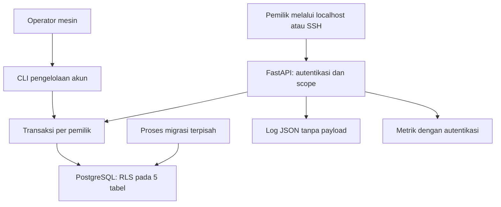
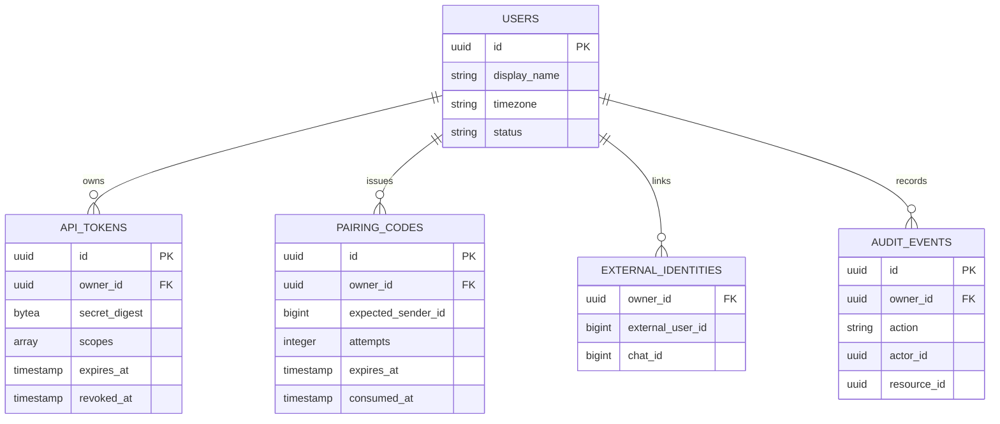
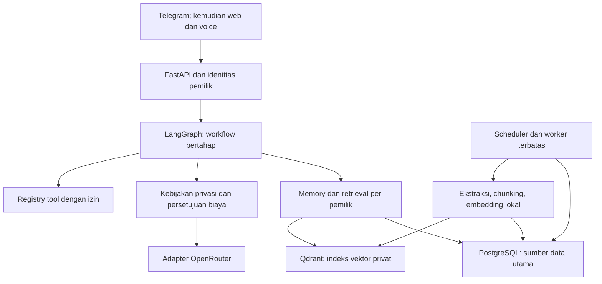

# Arsitektur fondasi dan tambahan Telegram

Rancangan memakai modular monolith: modul terpisah dalam satu aplikasi Python agar biaya
operasi kecil. Database dan worker dapat dipisahkan ketika ukuran pekerjaan membutuhkannya.
Seluruh integrasi yang belum ada ditandai sebagai rencana, bukan dianggap telah berjalan.

## Komponen yang diimplementasikan

API dan CLI menggunakan `jarvis_app`. Migrasi memakai `jarvis_migrator`; kredensialnya
tidak dipasang pada API. Bootstrap cluster memakai akun administrator image PostgreSQL,
yang juga tidak dipasang pada API. Database hanya berada pada jaringan Compose internal.
API bergabung ke dua network: `database` internal untuk PostgreSQL dan `api_access` bridge
untuk port host yang terikat ke `127.0.0.1`. Hanya API yang memakai `api_access`. Bridge
ini juga menyediakan jalur koneksi keluar API; pembatasan localhost bukan pemblokiran
trafik keluar. Integrasi LLM/dokumen belum aktif pada Tahap 1.

| Komponen | Tanggung jawab dan keputusan |
|---|---|
| FastAPI | Endpoint HTTP, pemeriksaan header, scope, validasi, error konsisten, health |
| Identity service | Penerbitan/pemeriksaan token, pencabutan, pairing untuk adapter mendatang |
| Database | Sesi async psycopg, transaksi, konteks pemilik lokal transaksi, readiness |
| PostgreSQL | Data utama, foreign key, uniqueness, row-level security, audit |
| Privacy policy | Keputusan kelayakan endpoint: tolak, gratis layak, atau perlu persetujuan |
| Configuration | Pydantic Settings, secret file, nilai batas, penolakan konfigurasi tidak aman |
| Logging | JSON terstruktur; tidak merekam body, query URL, authorization, traceback payload |
| Docker/CLI | Runtime non-root, migrasi sebelum API, pembuatan akun melalui operator |

Profil pada tahap ini hanya nama, zona waktu, dan status akun. **User profile memory
semantik dan conversation memory belum diimplementasikan.**

## Alur autentikasi dan isolasi

1. Token opaque berisi versi, kandidat owner UUID, token UUID, dan 32 byte acak URL-safe.
2. Database menyimpan HMAC-SHA256 seluruh token dengan pepper terpisah; token mentah
   hanya ditampilkan ketika diterbitkan. UUID dalam token bukan rahasia dan bukan bukti autentikasi.
3. Verifier membuka transaksi khusus kandidat owner untuk menemukan record token; tidak
   mengembalikan data pengguna sebelum digest, TTL, pencabutan, dan status akun lolos.
4. Endpoint memperoleh principal hasil verifikasi, mengecek scope, dan membuka transaksi
   dengan `set_config('jarvis.owner_id', ..., true)` yang berlaku lokal pada transaksi.
5. Semua tabel pemilik menggunakan `ENABLE ROW LEVEL SECURITY` dan `FORCE ROW LEVEL SECURITY`.
   Tanpa konteks pemilik, baris tidak terlihat. Filter owner juga dipakai pada query endpoint.
6. Transaksi dependency memakai `scope="function"`, sehingga commit terjadi sebelum
   respons sukses dikirim. Kegagalan commit menghasilkan error, bukan keberhasilan semu.

Token berlaku 1–90 hari; token awal 30 hari. Revokasi efektif untuk autentikasi baru,
bukan pembatalan otomatis transaksi yang sudah berjalan. `last_used_at` diperbarui paling
sering setiap lima menit untuk membatasi penulisan database.

RLS mengurangi risiko bug query lintas owner, tetapi GUC pemilik dapat diatur oleh proses
yang memiliki kredensial aplikasi. Karena itu RLS ini **tidak mengisolasi data dari
penyerang yang sudah menguasai proses aplikasi atau kredensial database**.

## Model data

`public.jarvis_schema_version` adalah metadata Alembic, bukan tabel data pengguna.
Audit tidak menyimpan token, isi prompt, atau dokumen. Role aplikasi hanya mendapat
SELECT/INSERT pada audit. Administrator database tetap dapat mengubah audit; ini bukan
log anti-tamper terhadap administrator.

Pairing adalah primitive internal untuk Tahap 2: hanya ID Telegram numerik yang ditetapkan
operator, private chat, TTL sepuluh menit, maksimal lima percobaan, dan konsumsi dengan row lock.
Token pairing tidak dapat dipakai sebagai bearer token API. Belum ada penerima pesan Telegram
atau endpoint publik untuk melakukan pairing.

## Struktur folder aktual

| Lokasi | Isi |
|---|---|
| `src/jarvis/main.py` | App factory dan lifespan |
| `src/jarvis/api/` | Routes, schemas, dependencies, middleware |
| `src/jarvis/core/` | Configuration, logging, application errors |
| `src/jarvis/identity/` | Token crypto, principal, auth, pairing, audit helper |
| `src/jarvis/storage/` | SQLAlchemy models dan transaction manager |
| `src/jarvis/policies/` | Kelayakan cloud berdasarkan privasi/biaya |
| `src/jarvis/cli.py` | Perintah operator tepercaya |
| `migrations/versions/` | Migrasi Alembic eksplisit dan immutable |
| `infra/postgres/` | Bootstrap role dengan hak minimum |
| `scripts/` | Generator secret dan bootstrap database test |
| `tests/unit/` | Konfigurasi, kriptografi, policy, HTTP boundary |
| `tests/integration/` | PostgreSQL native, RLS, auth, pairing/concurrency |
| `tests/sql/` | Verifikasi tambahan DDL/RLS melalui PostgreSQL WASM |
| `.github/workflows/` | CI unit, audit dependensi, integrasi dan Docker smoke |
| `docs/` | Keputusan, privasi, deployment, testing, hasil, roadmap |
| `Dockerfile`, `compose*.yaml` | Image production dan lingkungan test terisolasi |
| `pyproject.toml`, `uv.lock` | Definisi paket dan dependency lock |

## Arsitektur tujuan setelah tahap berikutnya

Modul Telegram sudah ditambahkan pada v0.2.0; modul berikutnya: `agents`, `routing`, `approvals`,
`memory`, `knowledge`, `ingestion`, `tools`, dan `jobs`. Folder kosong tidak dibuat untuk
menyiratkan fitur yang belum ada. Web/voice menggunakan kontrak layanan dan principal yang
sama; cookie browser, CSRF, CORS, serta autentikasi suara perlu desain tersendiri nanti.

LangGraph mengatur state/checkpoint dan penghentian untuk persetujuan. Keputusan akses,
budget, SQL, dan pemanggilan tool tetap berada di kode aplikasi, tidak diserahkan kepada LLM.
OpenRouter menjadi adapter awal; 9Router dapat ditambahkan di belakang kontrak yang sama
setelah provenance, lisensi, dan kebijakan data diperiksa. OpenClaw/Hermes belum menjadi
dependensi: integrasi hanya dilakukan bila ada kemampuan konkret yang dibutuhkan dan
bisa dijalankan dengan izin terbatas. Tidak ada agent yang diberi shell/Docker socket.

Rencana scalability: worker ingestion serial terlebih dahulu; kemudian worker terpisah,
queue/job durable PostgreSQL, pooling sesuai kapasitas database, dan storage terpisah.
Sebelum menambah replika API, pindahkan limiter proses-lokal ke limiter bersama/proxy tepercaya.

## Implementasi tambahan v0.2.0 — Telegram

Diagram dan struktur rinci ada di `STAGE_2A_DESIGN.md`. Telegram adalah worker terpisah
dengan koneksi keluar HTTPS. Ia memakai service identitas dan PostgreSQL yang sama,
tanpa melewati endpoint HTTP atau membutuhkan bearer API pemilik. Bot token hanya dipasang
pada worker; CLI pairing/status menggunakan kredensial aplikasi dan config tanpa token bot.

`telegram_state` menyimpan satu owner/bot, cursor, heartbeat, jendela pembatas laju, dan
jeda pengiriman global. `telegram_receipts` menggabungkan deduplikasi update dengan outbox
balasan: update ID, chat ID, template balasan, status, jumlah percobaan dan message ID.
Keduanya FORCE RLS. Tidak ada kolom raw JSON, teks input, dokumen, atau token Telegram.

Satu session advisory lock PostgreSQL melindungi poller per bot; tidak mendukung PgBouncer
transaction pooling pada koneksi lock. Jika koneksi lock hilang, worker berhenti. Lock
bukan fencing token yang dapat membatalkan request Telegram yang sudah terbang. Semua
pengiriman ditandai `sending` terlebih dahulu, sehingga startup mengubah pengiriman yang
belum selesai menjadi `uncertain` dan tidak otomatis mengulangnya.

Balasan statis merupakan implementasi perintah transport yang disengaja. Integrasi agent
berikutnya perlu outbox/event kontrak tambahan, retensi memory dan gerbang privacy/consent;
jangan mengganti template dengan hasil model tanpa mengimplementasikan gate Tahap 2B.

Kontrak API `/api/v1/policy` kini memiliki `stage: "2a"`,
`telegram_adapter_available: true`, dan `telegram_runtime_status: "check_telegram_status_cli"`.
Field lama `telegram_integration_active` dihapus karena API tidak dapat mengklaim worker
hidup hanya berdasarkan adanya kode. Gunakan `telegram-status` untuk status runtime.

## Implementasi Tahap 2B (v0.3.0)

Diagram dan keputusan terbaru berada di STAGE_2B_DESIGN.md. Assistant worker menjalankan
StateGraph dengan ID saja; journal domain PostgreSQL menyimpan snapshot dan transisi
request. Tidak memakai checkpointer umum tanpa RLS. Telegram menyimpan receipt `waiting`
sampai hasil/tawaran siap; jawaban premium memakai receipt update `/approve`, sehingga
receipt penawaran yang sudah terkirim tidak dikirim ulang. Lima tabel baru memakai FORCE
RLS dan composite FK owner/request. API tetap localhost. Adapter workflow/router/policy
terpisah; antarmuka web/voice nanti memerlukan adapter pengiriman sendiri, belum tersedia.
