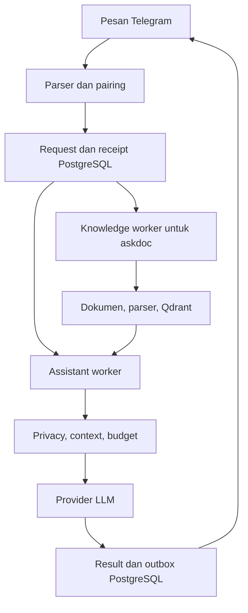

> Audit historis baseline 2 Oktober 2026. Beberapa temuan sudah ditangani sesudahnya; status terbaru dan batas verifikasinya ada pada `../DEVELOPMENT_STATUS.md` serta `RESUME_CHECKPOINT.md`.

# Audit KURO dan kelanjutan Stage 4–8

Tanggal: 2 Oktober 2026. Berdasarkan source ZIP dan catatan pengguna; tidak ada akses ke komputer, database, atau akun produksi. Status: audit sumber dan kandidat perbaikan.

## 1. Kesimpulan teknis

KURO masih sesuai tujuan sebagai asisten pribadi yang mengoordinasikan konteks, memori, dokumen dan tindakan melalui satu percakapan. Fondasi yang layak dipertahankan adalah PostgreSQL sebagai sumber status, FORCE RLS, worker terpisah, state LangGraph yang hanya membawa ID, pemisahan secret provider, dan persetujuan biaya per panggilan. Audit ini tidak menunjukkan kebutuhan untuk mengganti seluruh stack atau menambah framework agent baru.

Namun, klaim dalam catatan bahwa runtime sudah lengkap dalam revalidation, idempotency dan Calendar E2E perlu dikoreksi. Beberapa kemampuan ada sebagai komponen atau rancangan; jalur produk belum tersambung. Ada juga masalah nyata pada otorisasi teks dan pembaruan izin saat dispatch. Menambah banyak specialist sekarang akan memperbanyak jalur yang belum terbukti.

Target Stage 8 dapat dikerjakan bertahap. Hosting tidak harus menunggu semua specialist tersedia: private pilot bisa dilakukan setelah Stage 4 dan kebutuhan operasional Stage 5 lulus. Hosting membuat proses berjalan di server; ia tidak menyelesaikan integrasi yang belum ada di kode.

## 2. Baseline dan cakupan

ZIP berisi 260 entri, termasuk 221 file. Baseline memiliki 70 berkas Python di `src`, 36 di `tests`, 9 di `scripts`, dan 7 di `migrations`, dengan total baris masing-masing 6.937, 4.164, 1.008, dan 503. Root juga memuat tiga ZIP historis: `KURO_4_LETSGOO.zip`, `KURO_4_almost_final_maybe.zip`, dan `KURO_STAGE4_BASELINE.zip`. Source pada direktori luar dipakai sebagai baseline, bukan ditimpa arsip di dalamnya.

SHA-256 lampiran sumber:

```text
5285e2737f666544e550600c00ae15f3a5f26aed90d3f9d7ad3c7bbc9941c21c
```

Tidak tersedia dump produksi, volume dokumen, credential deployment atau akses server. Status container sehat, migration terpasang, 347 tes historis dan keabsahan OAuth tidak bisa dikonfirmasi dari ZIP. Metadata masih `personal-jarvis` versi `0.4.0`; penamaan internal Jarvis dipertahankan agar konfigurasi tidak rusak.

Inventaris mencakup runtime, konfigurasi, migrasi, tes, Compose, Dockerfile, script dan dokumentasi. Penelusuran mendalam difokuskan pada Telegram → assistant, retrieval dokumen, Calendar, policy, journal, broker, scheduler, dan batas credential. Ini bukan hasil penetration test maupun pembuktian formal seluruh perilaku program.

## 3. Arsitektur aktual

| Lapisan | Lokasi | Fungsi aktual |
|---|---|---|
| Identitas/API | `identity/`, `api/`, `core/` | Owner, token/scopes, pairing, middleware, health, audit |
| Database | `storage/`, `migrations/` | Tenant transaction, FORCE RLS, role terbatas, 6 revisi schema |
| Telegram | `interfaces/telegram/` | Private long polling, deduplikasi receipt, cursor, outbox |
| Assistant | `assistant/` | Antrean, profile/history, privacy/budget, OpenRouter, consent premium |
| Dokumen | `knowledge/` | Import lokal, OCR/parser, embedding, Qdrant per owner/document |
| Tool dan agent | `agents/`, `tools/` | Registri, effect class, scope, allow/approve/deny |
| Durable actions | `journal.py`, `execution.py`, `scheduler.py` | Persist, approve/cancel, claim, lease, dispatch, recovery |
| Calendar | `integrations/calendar/` | Spec, provider REST Google, OAuth, service, activation |
| Trusted intent | `orchestration/trusted_intent.py` | Pengikatan proposal; belum dipanggil worker produksi |
| Operasional | Compose, Dockerfile, `scripts/` | Build/test/startup/setup, backup PostgreSQL dasar |

Jalur percakapan dalam source:



Calendar memiliki jalur lain: service → journal → scheduler → broker → Google. Belum ada penghubung worker percakapan ke jalur itu. System prompt assistant menyatakan tidak memiliki tool/scheduler; itu masih sesuai kemampuan aktual dan tidak boleh sekadar dihapus agar model mengaku bisa melakukan tindakan.

## 4. Perbandingan dengan catatan terakhir

| Pernyataan | Hasil inspeksi |
|---|---|
| Parser belum menghasilkan `chat` | Sudah ada dalam ZIP; tes dan bantuan pengguna tertinggal |
| Gateway Calendar belum punya production caller | Benar; pemanggilan hanya ditemukan pada tes |
| Journal dan source timezone persisten | Benar pada migrasi 0005/0006 |
| Izin diperiksa ulang saat dispatch | Belum menyeluruh; current owner/scopes tidak diperiksa |
| Idempotency key diteruskan ke provider | Tidak ditemukan; fingerprint bukan pengganti otomatis |
| Hasil Calendar dilaporkan ke user | Belum; return value handler diabaikan broker |
| Action dapat dijadwalkan secara natural | Belum; service Calendar tidak meneruskan `due_at` |
| Credential Google terpisah dari assistant | Benar pada Compose, mounted di scheduler |
| Stage 4 selesai jika tes/migrasi hijau | Kriteria terlalu sempit; product acceptance belum terbukti |
| Backup/restore siap | Hanya helper `pg_dump` lokal; restore lengkap belum ada |

## 5. Temuan prioritas

### F01 — percakapan dan Calendar belum tersambung

`AssistantWorkflow.run()` hanya membuat plan LLM, dispatch inference, dan menyimpan jawaban. Tidak ada pemanggilan `CalendarIntentGateway`/`CalendarService` dari worker produksi. Memasang credential Google dan menjalankan scheduler tidak mengubah fakta ini.

Penutupan: planner menghasilkan proposal terstruktur tanpa authority; core mengikatnya ke ingress terverifikasi; read/write masuk worker eksekusi yang memiliki credential; hasil disimpan lalu dikirim melalui outbox. Jalur read juga harus menjaga secret Google tetap di executor. Jangan memasang secret pada assistant hanya untuk memudahkan integrasi.

### F02 — pencarian kata kerja memberikan authority yang salah

Fungsi baseline `_explicit_directive()` menganggap `Jangan buat rapat besok jam 10` dan `Bagaimana cara buat meeting?` sebagai instruksi eksplisit. Reproduksi lokal atas fungsi/pola regex sumber yang diisolasi menghasilkan `True` untuk keduanya. Argumen proposal juga tidak dibandingkan dengan waktu/judul yang diminta pengguna.

Kandidat Stage 4G menggantinya dengan pencocokan instruksi lengkap dan seluruh field untuk solo-create. Title atau waktu yang diganti model tidak memperoleh auto-authority. Bahasa bebas yang belum dapat dibuktikan memerlukan clarification/approval ketika orchestrator diimplementasikan. Logic matching lulus tes lokal; binder/gateway lengkap masih menunggu dependensi. Ini bukan klaim semua bahasa natural sudah dipahami.

### F03 — scope dan owner gateway belum ditegakkan pada baseline

Binder baseline memeriksa tool, agent dan key argumen, tetapi tidak menolak scope yang kurang sebelum meneruskan ke service. Service memakai scope sendiri saat membangun context. Kombinasi binder sempit dengan service luas dapat melonggarkan batas. Gateway juga belum membandingkan owner ingress dan journal layanan.

Patch menambah `missing_scope` pada binder dan `owner_mismatch` pada gateway. Flag autentikasi wajib boolean; teks/payload privat tidak ditampilkan pada `repr`. Regresi disiapkan, tetapi full pytest belum berjalan. Hak saat dispatch tetap merupakan F04 yang terpisah.

### F04 — dispatch belum memeriksa current authority

`ActionJournal.create()` memeriksa policy pada context yang diterima. Setelah itu `claim()`/`begin_dispatch()` memeriksa status, lease dan fingerprint. Broker tidak membaca ulang status owner, scope grant atau versi policy. Action queued belum punya jalur eksplisit untuk dihentikan karena owner/scope dicabut sebelum jadwalnya tiba.

Penutupan: persist sumber otorisasi serta referensi grant/revision; cek owner aktif, capability enabled, scope efektif dan approval binding secara transaksional tepat sebelum dispatch. Uji revoke saat queued, claimed, serta race cancel/dispatch. Perubahan ini membutuhkan integrasi DB nyata; belum ditambahkan secara spekulatif ke paket yang tidak dapat menjalankan gate native.

### F05 — fingerprint belum membuktikan idempotency eksternal

Fingerprint mengikat owner, tool dan arguments. `create()` selalu memberi UUID baru; tidak ada unique source-task/step key untuk mencegah action baru akibat pemrosesan ingress berulang. Adapter Google tidak mengirim event ID stabil pada create; hasil provider juga tidak direkam.

`uncertain` tanpa retry buta adalah perilaku konservatif yang berguna, tetapi belum membuktikan efek tepat sekali. Diperlukan deduplikasi ingress-to-action dan rekonsiliasi provider. Google mendukung event ID dari client; action ID dapat menjadi dasar identifier stabil, lalu hasil provider diperiksa ketika respons jaringan tidak diketahui. Dua instruksi identik yang sengaja dikirim pada kesempatan berbeda tidak boleh dianggap duplikat hanya karena fingerprint sama.

### F06 — hasil tindakan belum kembali ke produk

Broker melakukan `await handler(...)` lalu menandai sukses tanpa menyimpan return value. Service write hanya mengembalikan action ID/fingerprint. Event ID hasil create belum tersedia untuk follow-up edit/delete, dan belum ada outbox notifikasi hasil action.

Penutupan: persist hasil yang telah disaring, external reference, status dan receipt. Pisahkan kegagalan provider dengan kegagalan notifikasi. Retry pengiriman hasil tidak boleh menjalankan provider action lagi.

### F07 — lease dan klasifikasi kegagalan belum lengkap

Lease journal tetap 90 detik; kontrak tool mengizinkan timeout sampai 120 detik. Calendar sekarang memakai default 30 detik, jadi ini risiko runtime saat tool lain ditambahkan, bukan timeout Calendar yang sudah terbukti. Semua exception handler dikategorikan `uncertain`, termasuk validasi lokal/OAuth yang gagal sebelum write provider.

Penutupan: lease lebih panjang dari bounded execution atau renew dengan fencing; typed failure membedakan pre-dispatch failure dari hasil ambigu. Cancel setelah request provider dikirim tidak boleh dilaporkan sebagai rollback. Hilangnya satu lease perlu ditangani tanpa menghentikan seluruh scheduler secara tak tertelusur.

### F08 — schema dan batas provider masih perlu dikeraskan

Registry menyimpan key, bukan schema nilai lengkap. Handler mengubah banyak nilai ke `str`; validasi waktu/range/title/event ID/email belum menyeluruh. List events mengambil `items` sekali tanpa mengikuti `nextPageToken`. Rentang padat berisiko tidak lengkap. Klien OAuth/Google yang dibuat sendiri belum menonaktifkan `trust_env`, berbeda dari klien knowledge. Respons belum dibatasi ukuran byte secara eksplisit.

Penutupan: input schema ketat sebelum journal, window/page/event budget untuk read, validasi output, response-size limit, timeout, dan kebijakan proxy eksplisit. Invalid arguments sebaiknya gagal sebelum dispatch, bukan berubah menjadi outcome provider tidak pasti.

### F09 — natural chat dan bantuan pengguna tidak konsisten

Satu tes baseline masih mengharapkan teks biasa ditolak. Parser mempartisi token pertama pada `@` sebelum memeriksa slash command, sehingga alamat email di awal pesan dapat dianggap mention bot lain lalu diabaikan. Help/status/privacy hanya mengarahkan ke `/ask`.

Patch memperbaiki parser dan teks bantuan. Tes parser lulus; regresi native untuk queue, deduplikasi, pairing, safety dan premium telah ditambahkan tetapi belum dijalankan. Chat tetap memakai gate `/ask` yang sama; parser tidak diberi akses provider/tool.

### F10 — operations belum cukup untuk pemulihan server

`backup_local.py` menghasilkan custom-format `pg_dump` tanpa enkripsi. Signature dan status subprocess diperiksa, tetapi restore belum dibuktikan. Dokumen dan Qdrant ada di volume lain; backup DB saja tidak memulihkan knowledge lengkap. Scheduler belum mempunyai healthcheck/heartbeat seperti worker lain.

Penutupan: backup konsisten database + file + index atau rebuild yang diuji, enkripsi/offsite, restore disposable, monitor queue/heartbeat, rollback image/schema, rotasi secret, dan runbook insiden. Restore database tidak membatalkan event/email yang sudah terjadi di provider.

### F11 — dokumentasi mengesankan kematangan yang belum terbukti

README masih Tahap 3, `STAGE4_COMPLETE.md` mengklaim penutupan Stage 4, dan dokumentasi Calendar mengatakan secret dipasang di assistant padahal Compose memasangnya di scheduler. Catatan memuat angka tes berbeda. Manifest lama juga bukan checksum source setelah patch.

Patch memperbaiki pintu masuk dokumentasi dan kriteria completion. Nama file lama dipertahankan agar referensi tidak putus. Manifest sesi ini terpisah; bukti historis tidak dianggap hasil rilis sekarang.

## 6. Fondasi yang dipertahankan

**Data authority.** Tenant context bersifat transaction-local. Runtime menolak role superuser/BYPASSRLS dan ownership tabel aplikasi. Readiness memeriksa schema head dan FORCE RLS. Ini fondasi baik, tetapi tetap membutuhkan otorisasi domain saat eksekusi eksternal.

**Transport.** Sender privat, umur pesan, forwarded/delegated provenance, pairing, receipt, cursor dan outbox sudah dipikirkan. Pengiriman yang tidak pasti tidak diulang sembarangan setelah restart.

**Percakapan/biaya.** Context snapshot, config/revision, reservasi biaya dan premium consent berada di kode/DB. Graph membawa ID. Menambah tool tidak boleh memindahkan authority atau budget ke output model.

**Knowledge.** File diproses lokal dengan batas ukuran, parser/OCR terpisah, embedding multilingual 384 dimensi, filter owner+document di Qdrant dan validasi metadata sumber di PostgreSQL. Restricted document diblokir dari cloud. Kutipan private terpilih dapat keluar melalui `/askdoc`; ini bukan klaim seluruh percakapan selalu lokal atau regex secret dapat mengklasifikasi semua data sensitif.

## 7. Status tahap dan urutan pengembangan

| Tahap | Kondisi nyata | Bukti berikutnya |
|---|---|---|
| 4 — Close the loop | Komponen tersedia; integrasi/otorisasi belum lengkap | Natural Calendar sampai hasil, current permission, approval, recovery |
| 5 — Operations | Compose/health/backup dasar ada | Deploy ulang, monitoring, restore terenkripsi, rollback |
| 6 — Personal Intelligence | Profile/history dasar ada | Memory bersumber/proyek, context selection, konflik/retensi/forget |
| 7 — Specialists | Calendar dan retrieval dokumen parsial | Research, Documents, Email, Coding, Data, DevOps per vertical slice |
| 8 — Experience | Planner bertahap produksi belum ada | Planning bounded, follow-up, orkestrasi, budget global, local/cloud routing |

StateGraph tiga node yang ada adalah workflow inference/premium, bukan planner multi-step. Registri agent sendiri tidak membuat specialist baru fungsional.

Langkah pertama ialah memulihkan lingkungan uji lengkap dan menjalankan kandidat. Tutup F04–F08 sebelum write Calendar diekspos ke pengguna. Bangun slice read, create solo, approval invite/delete, scheduled execution, notifikasi, lalu recovery. Tambahkan migrasi baru untuk state baru; jangan mengubah migrasi yang sudah dipakai produksi. Setelah Stage 4 dan operasi minimum lulus, jalankan private pilot. Stage 6–8 dilanjutkan melalui lingkungan staging terpisah.

Tidak ada persentase kematangan atau tanggal selesai yang bisa dibuktikan dari satu ZIP. Provider specialist, kebutuhan data, target biaya dan server belum diputuskan. Acceptance terukur tersedia di `STAGE_4_8_ACCEPTANCE.md`, hosting di `HOSTING_READINESS.md`. Tidak ada specialist dummy yang diberi label selesai.

## 8. Batas verifikasi sesi ini

24 tes standard-library yang memanggil parser/helper produksi lulus. Semua Python yang diperiksa dapat di-parse. Full pytest, lint, native DB, Docker dan provider E2E belum dapat dijalankan: dependensi belum tersedia dan peninjauan izin unduhan gagal akibat batas penggunaan. Docker/PostgreSQL juga tidak tersedia pada lingkungan ini. Tidak ada percobaan mengakali kontrol izin dan tidak ada stub DB yang dihitung sebagai integrasi nyata.

Angka 347 PASS merupakan laporan historis pengguna, bukan hasil kandidat ini. Keterbatasan verifikasi menghentikan klaim siap rilis. Stage 4–8 belum dinyatakan selesai.

## Referensi primer untuk desain lanjutan

- [Docker Compose in production](https://docs.docker.com/compose/how-tos/production/): deployment Compose pada server.
- [Telegram Bot FAQ](https://core.telegram.org/bots/faq): long polling dan webhook.
- [Google Calendar events.insert](https://developers.google.com/workspace/calendar/api/v3/reference/events/insert): client-supplied event ID sebagai bahan desain rekonsiliasi.

Referensi diperiksa 2 Oktober 2026. Temuan kode berasal dari source lampiran.

