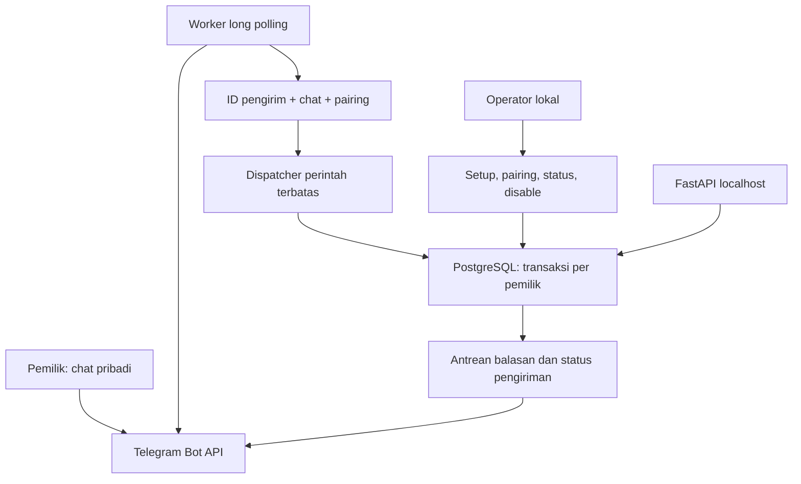

# Rancangan Tahap 2A — Telegram privat

Status rancangan sebelum implementasi, 28 September 2026. Tahap 1 telah diuji pengguna:
migrasi, readiness dari Windows, RLS, akses tanpa token 401, akses token pengganti 200,
dan pencabutan token yang sempat dibagikan. Dua hotfix Windows/jaringan menjadi baseline.

## Batas tahap

Tahap 2 dipecah menjadi 2A (transport Telegram dan identitas) dan 2B (workflow LangGraph,
model routing, memory, persetujuan premium, serta usage ledger). Pemisahan ini memberi
gate validasi nyata sebelum isi percakapan dikirim ke provider model. Tahap 2A tidak
memanggil model, mengunduh lampiran, atau menjalankan tool dari teks pengguna.

## Diagram arsitektur



Worker membuka koneksi HTTPS keluar ke `api.telegram.org`; tidak memiliki port masuk.
PostgreSQL tetap internal. API tetap di localhost. Long polling tidak membutuhkan domain,
reverse proxy publik, webhook, Redis, atau VPS baru untuk pengujian lokal.

## Struktur tambahan

```text
src/jarvis/interfaces/telegram/
    config.py          konfigurasi ketat dan file secret
    client.py          transport HTTPS terbatas dan klasifikasi kegagalan
    commands.py        validasi update dan balasan dari template tetap
    repository.py      cursor, receipt, outbox, pembatas laju, dan isolasi owner
    worker.py          lifecycle, lock satu poller, polling dan delivery
    cli.py             status, pairing, disable, dan healthcheck
migrations/versions/0002_telegram.py
scripts/setup_telegram.py
scripts/backup_local.py
compose.telegram.yaml
tests/unit/test_telegram_*.py
tests/integration/test_telegram.py
docs/STAGE_2A_DESIGN.md
docs/TELEGRAM_WINDOWS.md
```

## Komponen dan jaminan

| Komponen | Perilaku |
|---|---|
| Setup lokal | Token dimasukkan tersembunyi; challenge dikirim pemilik ke bot sendiri; ID numerik dikonfirmasi lokal; file lama tidak ditimpa |
| Gate | Hanya ID yang dikonfigurasi, `is_bot=false`, private chat dengan ID chat sama dengan sender, owner aktif; username bukan identitas |
| Pairing | Kode sekali pakai, sepuluh menit, lima percobaan; identitas, receipt dan cursor ditulis dalam transaksi yang sama |
| Dispatcher | `/start`, `/help`, `/pair`, `/status`, `/privacy`; teks biasa mendapat penjelasan batas tahap; lampiran tidak diunduh |
| Persistence | Tabel state dan receipt/outbox memakai FORCE RLS; tidak menyimpan teks input atau kode pairing mentah |
| Poller | Satu PostgreSQL advisory lock per bot; offset disimpan hanya setelah transaksi berhasil; update berulang tidak mengulang efek |
| Delivery | Intent dicatat sebelum send; timeout ambigu menjadi `uncertain` dan tidak otomatis dikirim ulang; kegagalan yang pasti belum terkirim dapat dicoba terbatas |
| Operasional | Retry berjarak, batas antrean, retensi receipt, heartbeat, status aman, graceful shutdown dan startup recovery |

Tidak ada klaim exactly-once untuk pengiriman Telegram: API pengiriman tidak menyediakan
kunci idempotensi. Pilihan tahap ini menghindari retry otomatis pada hasil ambigu; pemilik
dapat mengirim perintah baru jika balasan hilang. Hanya template statis yang disimpan di
outbox, bukan isi dokumen atau percakapan.

## Rencana deployment

1. Jalankan pengujian dengan database disposable dan Telegram mock; API Telegram sungguhan
   tidak dipakai oleh test suite.
2. Buat backup lokal sebelum migrasi; ekstrak upgrade ke proyek yang sama agar volume dan
   secret lama dipertahankan. Rebuild image, terapkan migrasi tambahan, periksa readiness.
3. Buat bot khusus melalui BotFather. Jalankan setup tersembunyi di komputer pemilik;
   jangan mengirim token lewat chat ini.
4. Mulai worker dengan Compose overlay, buat kode pairing dari CLI, lalu uji `/pair`,
   `/status`, `/privacy`, penolakan akun lain, dan restart.
5. Terima 2A setelah validasi pengguna. Lanjutkan 2B tanpa mengaktifkan premium otomatis.

Target infrastruktur tetap sekitar Rp100.000/bulan. Worker terpisah memiliki batas memori,
memakai database yang sudah ada, dan tidak menambah langganan atau layanan berbayar.
Komputer dan Docker harus menyala agar long polling lokal berjalan.

## Checklist keamanan sebelum penerimaan

- [ ] Token hanya di secret worker; tidak berada pada API, log, image, argv, atau artefak.
- [ ] Akun asing, grup, channel, pesan forward, bot, update edit/business ditolak.
- [ ] Pairing terikat owner/sender; upaya salah, kedaluwarsa dan replay diuji.
- [ ] RLS, transaksi rollback, duplikasi update dan lock poller diuji pada PostgreSQL native.
- [ ] HTTP redirect/proxy lingkungan dinonaktifkan; tujuan HTTPS tetap; response dibatasi.
- [ ] Retry 429 mengikuti jeda; hasil kirim ambigu tidak diduplikasi otomatis.
- [ ] Akun suspended atau identity disabled menghentikan balasan yang belum dikirim.
- [ ] Status/heartbeat tidak mencetak isi pesan, nama file, kode pairing, atau token.
- [ ] Worker tidak memiliki published port; database tidak dipublikasikan.
- [ ] Backup/upgrade/restart diuji sesuai cakupan dan keterbatasan dilaporkan.

## Privasi

Chat bot adalah layanan cloud Telegram, bukan Secret Chat E2EE. Pembatasan owner di Jarvis
tidak menghilangkan pemrosesan oleh Telegram. Tahap ini tidak mengirim konten ke provider
LLM dan tidak mengunduh file, tetapi pesan yang dikirim melalui Telegram sudah melewati
Telegram. Dokumen sensitif nantinya diunggah melalui jalur privat tersendiri. Kebijakan
no-training/ZDR untuk provider model tidak berlaku otomatis pada Telegram.

## Referensi primer

- https://core.telegram.org/bots/api#getupdates
- https://core.telegram.org/bots/api#sendmessage
- https://core.telegram.org/bots/features#botfather
- https://telegram.org/privacy
- https://telegram.org/faq#q-how-are-you-going-to-encrypt-data
- https://www.python-httpx.org/advanced/timeouts/
- https://www.python-httpx.org/environment_variables/
