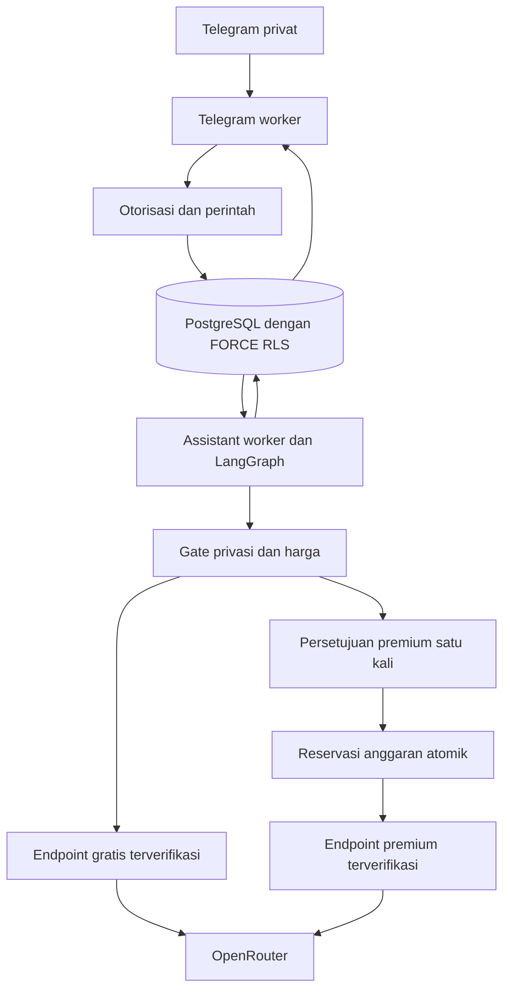

# Tahap 2B — rancangan sebelum implementasi

Tanggal rancangan: 2026-09-28. Prasyarat: Tahap 2A, migrasi, pairing dan restart
Telegram sudah divalidasi pemilik. Pengujian akun asing manual belum dilaporkan.
Tahap ini menambah percakapan teks AI; dokumen/Qdrant, tools, scheduler pekerjaan,
voice, dashboard dan deployment VPS tetap tahap berikutnya.

## Arsitektur



Telegram tidak memegang API key OpenRouter. Assistant tidak memegang token bot.
API FastAPI dan operator memakai kredensial runtime dengan RLS; migrator terpisah.
Jaringan egress Docker bukan firewall domain: host/VPS memerlukan kontrol sendiri.
Worker AI tunggal per pemilik menggunakan advisory lock PostgreSQL. Hilangnya
koneksi lock menghentikan worker. Transaksi dispatch yang sudah committed tidak
pernah otomatis dikirim ulang, termasuk setelah crash. Ini at-most-once attempt,
bukan jaminan exactly-once pada layanan eksternal.

## Struktur tambahan

```
src/jarvis/assistant/
  config.py        # konfigurasi ketat, premium USD0 secara default
  policy.py        # klasifikasi, snapshot, digest, batas konteks
  router.py        # katalog, ZDR, harga, HTTP tanpa retry atau redirect
  repository.py    # journal, memory, consent, ledger, retention dan RLS
  graph.py         # StateGraph guard/route/dispatch/record
  worker.py        # lock, recovery, heartbeat dan cleanup
  cli.py           # enable/disable/status/health/catalog
migrations/versions/0003_assistant.py
scripts/setup_assistant.py
compose.assistant.yaml
tests/unit/test_assistant_*.py
tests/integration/test_assistant.py
```

## Keputusan komponen

- `/ask TEKS` adalah tindakan eksplisit mengirim konteks ke cloud; teks biasa
  belum otomatis menjadi prompt. Lampiran tidak diunduh. `/restricted` ditolak
  tanpa menyimpan argumennya. Filter pola secret membantu, bukan detektor sempurna.
- `/remember kunci nilai` menyimpan fakta pilihan pemilik untuk konteks AI;
  `/memory` menampilkan fakta, `/forget kunci` menghapusnya. Tidak ada inferensi
  model yang diam-diam menjadi profil permanen. Maksimum 20 fakta.
- Riwayat disimpan 30 hari; konteks memakai maksimum 12 pesan terakhir dalam
  percakapan aktif. `/new` memulai percakapan; `/clear` membersihkan isi riwayat,
  snapshot request dan teks receipt AI lokal. Profil dihapus melalui `/forget`.
  Billing/audit tanpa isi prompt dipertahankan. Salinan backup dan Telegram
  tidak terhapus oleh perintah lokal ini.
- Satu request belum selesai per pemilik. Snapshot konteks dibekukan; perubahan
  profil/percakapan membatalkan request tertunda. Hasil panggilan yang sudah
  dikirim dapat dibuang, tetapi data yang sudah terkirim tidak dapat ditarik.
- LangGraph memakai state ID saja. Journal domain PostgreSQL adalah sumber
  recovery. Tidak menggunakan InMemorySaver atau checkpointer generik tanpa RLS.
  Tidak ada LangSmith tracing, SDK auto-retry, tool provider atau plugin cloud.
- Katalog OpenRouter diperiksa sebelum dispatch. Endpoint harus muncul pada
  daftar ZDR dan katalog endpoint model yang sama. Model/provider dipilih
  eksplisit; data_collection=deny, zdr=true, allow_fallbacks=false,
  require_parameters=true, dan max_price diterapkan pada setiap request.
  Model gratis harus berharga nol untuk seluruh dimensi biaya yang diterima.
  Ketidakjelasan metadata menghentikan request. Katalog bisa berubah sewaktu-waktu.
- Pemilik perlu menonaktifkan input/output logging dan training opt-in di akun
  OpenRouter serta mengaktifkan ZDR. ZDR bergantung pada kebijakan provider;
  caching sementara dalam memori dapat dianggap kompatibel oleh OpenRouter.
  Ini bukan jaminan tidak ada pemrosesan oleh pihak ketiga.
- Premium nonaktif sampai rute serta budget per-call dan bulanan dikonfigurasi.
  Setiap percobaan membutuhkan `/approve KODE` baru, TTL 5 menit, terikat owner,
  snapshot, model, provider, harga, output limit dan revisi konfigurasi. Kode
  disimpan sebagai HMAC; teks penawaran outbox dibersihkan setelah pengiriman.
  Persetujuan tidak dapat diberikan oleh model. Tidak ada premium auto-retry.
- Reservasi konservatif: harga prompt dikali kapasitas input endpoint penuh,
  ditambah batas output dan biaya request. Ini sengaja lebih besar daripada
  perkiraan tagihan aktual. Metadata biaya yang tidak didukung ditolak.
  Transaksi mengunci state pemilik, memeriksa ledger bulan UTC dan mencadangkan
  biaya sebelum panggilan. Timeout/crash/biaya tidak diketahui mempertahankan
  reservasi. Pelanggaran harga/identitas respons membekukan worker.
- Rp100.000 tetap target infrastruktur, bukan janji harga VPS atau nilai tukar.
  Budget model disimpan USD terpisah dan default nol. Tidak membeli VPS/top-up.
- OpenClaw/Hermes/9Router belum ditambah: belum memberi manfaat untuk alur ini
  dibanding tambahan akses/operasi. Boundary router dan workflow memungkinkan
  adapter berikutnya. Tool eksekusi tetap belum aktif pada tahap ini.

## Deployment plan

1. Tes regresi dan migrasi di database Docker terpisah; tidak menyentuh volume
   produksi. Buat backup lokal sebelum upgrade, pertahankan semua `.secrets`.
2. Hentikan worker Telegram, upgrade kode/migrasi ke 0003_assistant dan hidupkan
   API/Telegram. Validasi doctor, readiness dan status. AI tetap nonaktif.
3. Wizard lokal menerima key secara tersembunyi dan memilih rute dari metadata
   publik. Tidak melakukan inference/charge. Kredensial baru terpisah dari
   kredensial Tahap 1/2A. Tidak ada overwrite otomatis.
4. Jalankan assistant worker dan aktifkan melalui CLI. Kirim `/ask` pendek yang
   tidak sensitif; cek ledger/status. Validasi restart, memory, clear, penolakan
   akun asing dan per-call premium (jika kemudian dikonfigurasi).
5. VPS/HTTPS/backup terenkripsi/restore test dan monitoring penuh adalah gate
   tersendiri. Readiness bukan bukti seluruh sistem aman atau production accepted.

## Security checklist tahap ini

- [ ] FORCE RLS pada tabel baru dan composite FK antar-owner.
- [ ] Owner aktif dan identitas Telegram diperiksa saat enqueue dan dispatch.
- [ ] Kode approval sekali pakai, kedaluwarsa dan tidak tampil di log.
- [ ] Tidak ada retry premium, fallback provider atau eskalasi biaya otomatis.
- [ ] Harga/budget ditolak jika metadata tidak lengkap atau berubah.
- [ ] Restricted/secret terdeteksi tidak masuk jalur inference.
- [ ] Penghapusan/revisi membatalkan snapshot tertunda dan membuang hasil lama.
- [ ] Prompt/output tidak masuk log, metric label atau tracing eksternal.
- [ ] HTTP fixed-origin, TLS, trust_env=false, tanpa redirect, timeout/size bound.
- [ ] Crash dispatch menjadi uncertain; ledger tetap menahan reservasi.
- [ ] Kredensial lama, volume, owner dan pairing tetap dipertahankan.
- [ ] Tes native PostgreSQL dan validasi lokal pemilik sebelum tahap berikutnya.

Sumber teknis resmi: https://openrouter.ai/docs/guides/features/zdr ;
https://openrouter.ai/docs/guides/routing/provider-selection ;
https://openrouter.ai/docs/api/api-reference/endpoints/list-all-endpoints-for-a-model ;
https://docs.langchain.com/oss/python/langgraph/graph-api .
